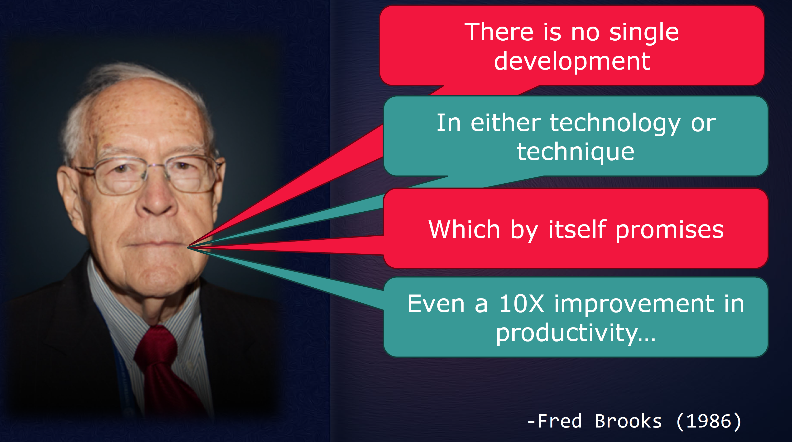

# The Silver Bullet?

### What has the research found?

1. **METR — July 10, 2025**  
   In a randomized study of 16 experienced open-source developers, AI-assisted work took **19% longer**, despite developers expecting a 24% speedup. [METR study](<https://metr.org/blog/2025-07-10-early-2025-ai-experienced-os-dev-study/>)
2. **NBER — May 2026; revised September 2026**  
   Across more than 500,000 developers, AI increased commits substantially, but that only improved **actual releases** by about **30%**, suggesting bottlenecks downstream of coding. [NBER study](<https://www.nber.org/papers/w35275>)
3. **MSR — April 13, 2026**  
   Coding-agent adoption increased development activity, but also increased static-analysis warnings by roughly **18%** and cognitive complexity by about **39%**. [MSR study](<https://2026.msrconf.org/details/msr-2026-mining-challenge/29/AI-IDEs-or-Autonomous-Agents-Measuring-the-Impact-of-Coding-Agents-on-Software-Devel>)
4. **IEEE Transactions on Software Engineering — March 31, 2026**  
   AI users achieved more than twice the median task completeness, but their ability to answer technical questions about their own code fell by **12\.5%**. [IEEE study](<https://ieeexplore.ieee.org/document/11458664/>)

### AI generating code "by itself" IS NOT the answer!
