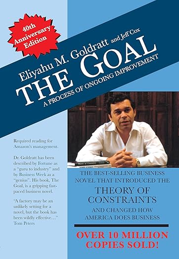
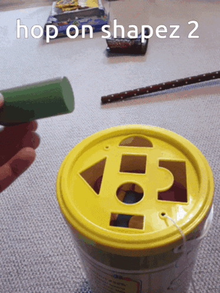

# The Goal

### A few ideas from [[The Goal]]

- **Productivity is not busyness.** An action is productive when it moves the system toward its goal.
- **Local efficiency is not system throughput.** Making one step faster can create inventory at the next constraint.
- **Focus on the constraint.** Prioritize the bottleneck, increase its throughput, eliminate unnecessary work through it, and protect it from poor-quality input.

### Three measures

- **Throughput:** valuable outcomes completed by the system
- **Inventory:** work started but not yet delivering value
- **Operating expense:** the people, tools, and time required to move work through the system ~ not just money

---

### Let's check on our factory

---
### In Most Companies
In most companies the Goal is to **make money...**

- What is BYU's goal?
