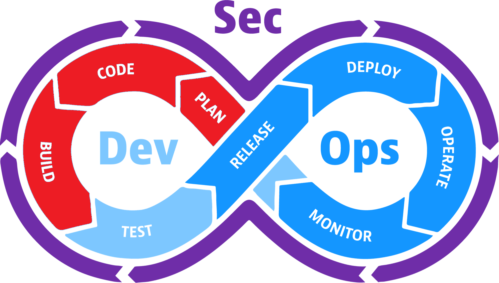

# Plan, Code, & Build

### Where it bottlenecks

- The backlog grows because the problem, user, or success criteria are unclear.
- Business rules and constraints are discovered after development begins.
- Architecture, build time, CI capacity, or the code–build–test loop limits flow.

### What might improve flow?

- Confirm that the feature advances the mission before investing in implementation.
- Use clear acceptance criteria, shared domain language, TDD, and fast CI feedback.
- AI can expose ambiguity, challenge assumptions, prototype quickly, and accelerate small changes.

### Security questions

**What security requirements and abuse cases should influence the design?**

**Are dependencies, secrets, permissions, and generated artifacts handled securely?**
