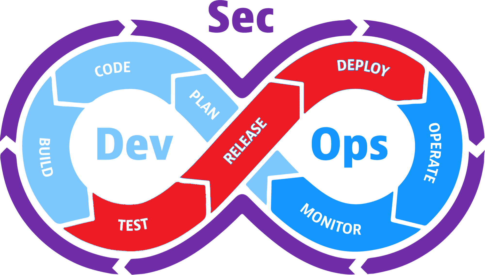

# Test, Release, & Deploy

### Where it bottlenecks

- Pull requests, manual tests, UAT, or security review form a queue.
- Reviewers cannot keep up with the size or number of changes.
- Releases require manual steps, risky changes are too large, or rollback is difficult.

### What might improve flow?

- Use small pull requests, explicit review ownership, automated tests, and risk-based security checks.
- Use small batches, progressive delivery, feature flags, and easy rollback.
- AI can suggest edge cases and draft tests, but people still establish confidence and own the release decision.

### Security questions

**Have we verified the highest-risk behaviors, not just the happy path?**

**Are vulnerabilities, secrets, permissions, and production configuration checked before release?**

**Can we quickly disable or roll back a release if abuse or a vulnerability is discovered?**
