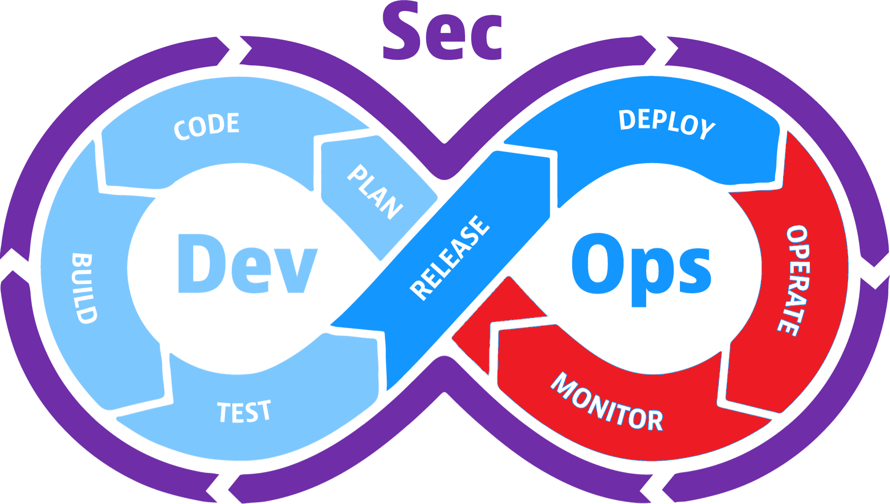

# Operate, Monitor, & Feedback

## Was the feature productive toward BYU's goal?

### Where it bottlenecks

- Alert noise hides important signals, and system behavior is difficult to explain.
- Incidents take too long to identify, understand, and route.
- User feedback, incidents, and known issues do not change the plan.

### What might improve flow?

- Invest in useful telemetry, low-noise alerts, runbooks, and incident ownership.
- Gather user feedback and outcome metrics, then create explicit follow-up work.
- AI may summarize logs and feedback, but people decide whether the work advanced the mission.

### Security questions

**Do logs or user responses expose sensitive data?**

**Can we detect misuse or system compromise, and do we trust the feedback?**
