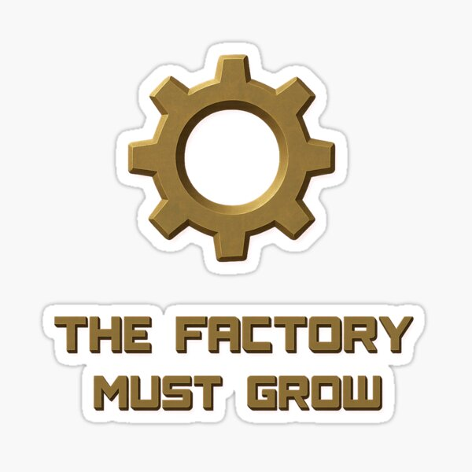

# Improve the System

### Fix the factory

1. **Remove unnecessary work** before it reaches the bottleneck.
2. **Filter defects earlier** so the bottleneck does not spend time on bad inputs.
3. **Increase flow through the constraint** before upgrading everything else.

### Use AI where it amplifies the system

- Use it for bounded prototypes, information synthesis, assumption-checking, drafts, and edge-case exploration.
- Keep humans responsible for mission, architecture, security, judgment, and acceptance.

> The question is not: Can this station go faster?
>
> The question is: Which change helps the University move toward its goal?

---
## Find the constraint.

## Improve the system around it.
